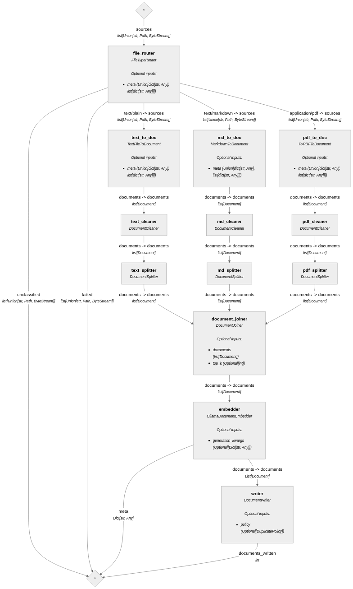
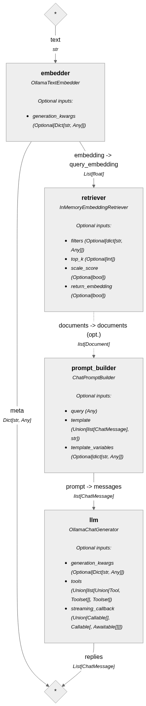
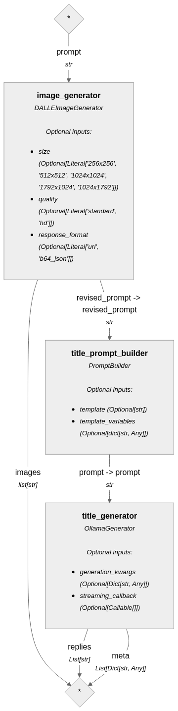

# Capstone Project

Author: Esguerra, Phillip Amir

## Project Initialization

To initialize the project, follow the steps below:

### Requirements

- Python 3.13

### Using `uv` (Preferred Method)

1. Ensure you have `uv` installed. If not, install it using pip:

   ```bash
   pip install uv
   ```

2. Activate the virtual environment (if created):

   ```bash
   source venv/bin/activate  # On Windows, use `venv\\Scripts\\activate`
   ```

3. Restore the project environment using `uv`:

   ```bash
   uv restore
   ```

### Using `requirements.txt` (Alternative Method)

1. Ensure you have Python installed on your system.

2. Create a virtual environment (optional but recommended):

   ```bash
   python -m venv venv
   source venv/bin/activate  # On Windows, use `.venv\\Scripts\\activate`
   ```

3. Activate the virtual environment:

   ```bash
   source venv/bin/activate  # On Windows, use `.venv\\Scripts\\activate`
   ```

4. Install the required dependencies:

   ```bash
   pip install -r requirements.txt
   ```

## Configuration

The project configuration is designed to be simple and flexible. Below are the details of the configuration setup:

### `.env` File

- The `.env` file contains sensitive API keys required for the project to function. This file will be included in the project submission but the API keys will be deleted days after grading.
- Checkers can provide their own API keys by updating the `.env` file.

### Default Configuration

- The project is configured to use cloud-based models instead of local models.
- By default, any documents uploaded during a session will be stored in memory and discarded after the console session ends.
- Default configuration uses OpenAI models for embedding, query and image generation.

### **No Further Changes Needed in Configuration**

- Once the project is sent, no changes are required in the configuration. The setup is ready to use as is.

## Usage

To run the application, follow these steps:

1. Navigate to the project directory in your terminal.

2. Activate the virtual environment (if created):

   ```bash
   source venv/bin/activate  # On Windows, use `venv\\Scripts\\activate`
   ```

3. Run the application using the following command:

   ```bash
   python main.py
   ```

4. At first prompt, provide your name for a better user experience.

5. To terminate the chat session, you can use any of the following commands:
   - `/bye`
   - `/exit`
   - `/quit`

## Architecture

### RAG Pipeline

- Use inmemory and discard the file after use
- limited to simple embedding search
- for better context management, it will be ideal to do
  - summarization of chunks
  - add hierarchichal or sliding window summarization function to summarize the whole file

### Decision Records

| Concern | Context | Resolution |
| --- | --- | --- |
| Use of LangChain | Based from previous experience, use of LangChain is very challenging. Community notes varies from version to version and the documentation is difficult to navigate. | Use Haystack as framework |
| Agent Orchestration | Manually inspecting the response of the orchestrator agent will introduce coupling if more agents is introduced, in terms of adding it to context. | Wrap other agents as a tool and make it as toolset for the Orchestration Agent |
| Weather API | Been seeing issues with the Open Weather API especially in customizing responses. | Use VisualCrossing API. Forecast data is also limited to 14-15 days only. |
| Events Data | There are no free API for getting events. And if there is any, it might be lacking data. Sample data is in `./.assets/sample_events.csv` | Use mock data that is seeded in the database and will only provide events for the next 14 days |

## Technical Details

### Project Structure

- **.assets/**: Contains assets related to the project.
- **.python-version**: Specifies the Python version for the project.
- **README\.md**: Includes project documentation.
- **config\.py**: Contains configuration settings or parameters.
- **main\.py**: The primary script for the project, driving the main functionality.
- **pyproject.toml**: Configuration for Python tools and dependencies.
- **requirements.txt**: Lists project dependencies.
- **uv.lock**: A lock file for dependency management.
- **agents/**: Includes agent-related implementations or modules.
- **helpers/**: Contains helper functions or utilities.

### Models

| Model Name | Use Case |
|---|---|
| `gpt-4o-mini` | General chat responses |
| `text-embedding-ada-002` | Embedding |
| `dall-e-3` | Image generation |

### Agent Structure and Orchestration

| Agent Name | Details |
|---|---|
| Orchestrator | The main agent that the user will chat with. It will refer to other agents depending on the task. This agent acts as the central hub, ensuring seamless communication and delegation of tasks to specialized agents. |
| Document | Document question answering agent. This agent is designed to process and answer questions based on the content of uploaded documents. It supports various file formats such as PDF, markdown, and plain text. |
| Events | Provide events based on the seeded sample event data. This agent retrieves and filters events from a mock database, ensuring relevance to the user's query. It is limited to providing events for the next 14 days. |
| Image Generation | An agent that has the capability to generate images based on the provided user prompt. It uses advanced generative models to create high-quality images and saves them with unique filenames. Uses OpenAI DallE image generation model. |
| Recommendations | Uses web search capability to provide recommendations. This agent leverages live web search to gather and present tailored suggestions based on the user's input. |
| Weather | Uses a live weather API to provide weather information. This agent fetches real-time weather data, including forecasts, using the VisualCrossing API. It is limited to providing forecast data for up to 15 days. |

### Pipelines

The following pipelines are used in the project.

#### Ingestion

The main use of the ingestion pipeline is to ingest document in the application's memory. This pipeline can read markdown, PDF and text files.

The pipeline can be visualized as follows:



#### Query

The query pipeline uses the same document store from the ingestion pipeline which is stored in application's memory. This pipeline has the capability provide Q&A based on user prompt and the documents stored from the ingestion pipeline.



#### Image Generation

This is a simple pipeline that generates an image from user prompt and save the image file with a file name generated from the image.



## Sample

See sample conversation in `./.assets/sample/`. Check the video recording at `./.assets/sample/screen-recording.mov`.
