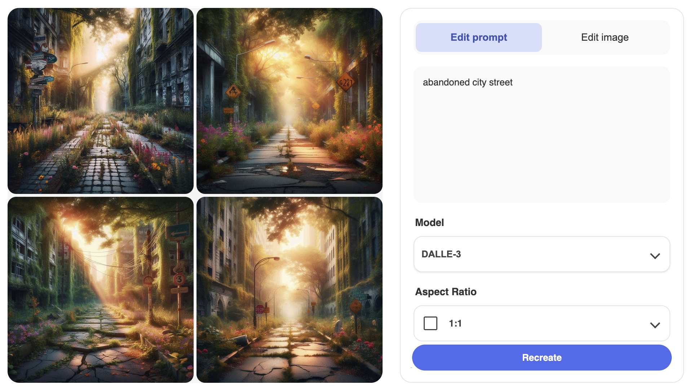
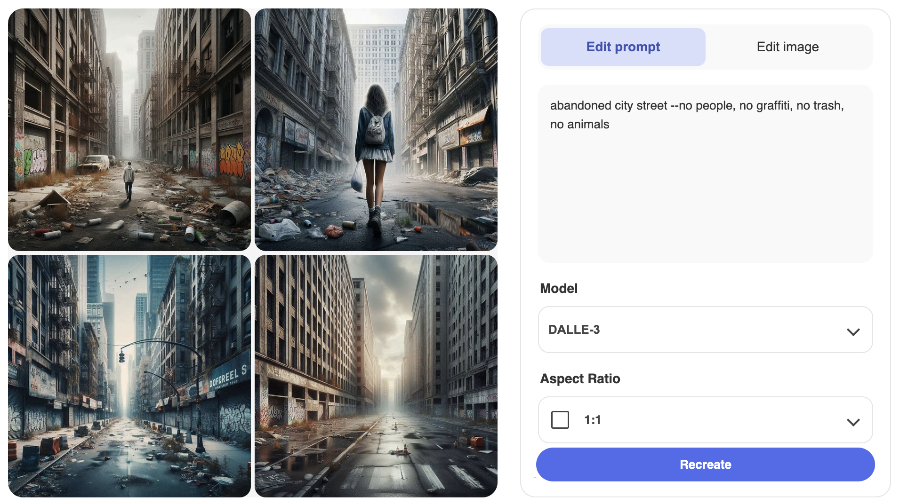

# Module 10 - Capstone Project Part 3.1

> Submitted by Phillip Amir Esguerra

## Task 1: Basic vs Detailed Prompts

### 1. Prompt 1

> mountain landscape snow-capped mountain peaks at sunrise, golden light, wispy clouds, telephoto lens, crisp detail, 4k

|  |  |
|---|---|
|  |  |

### 1. Prompt 2

> a wizard elderly wizard in flowing dark blue robes, intricate silver embroidery, holding a wooden staff, soft studio lighting, portrait photography style

|  |  |
|---|---|
|  |  |

### Task 1: Interpretation

In the first prompt it looks like it followed the prompt properly the golden light of a sunrise, telephoto lens looks and crisp detail. Although the wispy clouds were not followed maybe a bit on the fourth image but the rest looks like cumulus clouds.

For the wizard prompt, it clearly followed the prompt and the detail on the silver embroidered robes were spot on. Studio light were perfect including the studio-like backgrounds. All were holding a wooden staff and wear blue robes.

## Task 2: Working Around Trigger Words

### 2. Prompt 1

> robot dancing in a nightclub humanoid figure in fluid motion, dark environment with colourful spotlights, dynamic pose, metallic surface reflections

|  |  |
|---|---|
|  |  |

### 2. Prompt 2

> magical forest with fairies misty woodland at dawn, small points of bioluminescent light between trees, ethereal atmosphere, soft bokeh effect

|  |  |
|---|---|
|  |  |

### Task 2: Interpretation

In the first prompt, all looks perfect in terms of lighting and the 'fluid motion' pose, although in the first image the lights curved like fluid :). Others, the strobe lights looks perfect, and the metallic surface on the humanoid robot looks great.

In the second prompt, I wast expecting a fairy with wings flying around, but all generated images looked like wisps perhaps this may be the 'biolumenescent lights' in the prompt. The wisp, surprisingly a type of fairy according to my light research, is captured in bokeh which is looks good. It also captures the ethreal atmosphere of a misty forest

## Task 3: Negative Prompt Practice

### 3. Prompt 1

> abandoned city street

|  |  |
|---|---|
|  |  |

Screenshot:

### 3. Prompt 2

> abandoned city street, no people

|  |  |
|---|---|
|  |  |

Screenshot:

### 3. Prompt 3

> abandoned city street --no people, no graffiti, no trash, no animals

|  |  |
|---|---|
|  |  |

Screenshot:

### Task 3: Interpretation

Interestingly, comparing prompt 1 and 2, prompt 1 is correct it being an abandoned city street, but in prompt 2 where it mentioned the 'no people' prompt, it added a person center in the image. Same goes for prompt 3 where it added a person, grafitti and trash around, although correct that there are no animals around. Looks like putting in negative prompt does make the model confused so it added those elements in.
